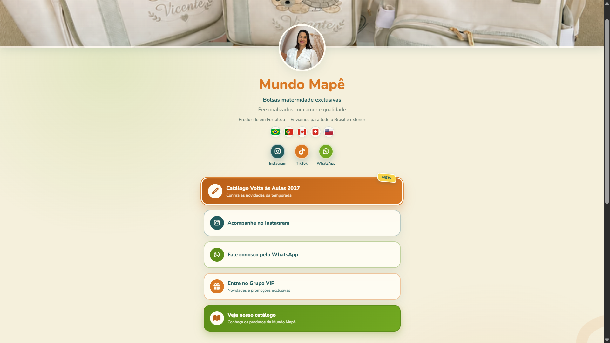

# Mundo Mapê — Link da Bio

Página de links da **Mundo Mapê**, criada para reunir os canais da marca, apresentar seus produtos e facilitar o contato com clientes. O layout é responsivo e usa as cores e imagens da identidade visual da marca.

## Prévia do site



## Funcionalidades

- Acesso rápido ao Instagram, TikTok e WhatsApp
- Destaque para o catálogo Volta às Aulas
- Link para o catálogo de produtos
- Grupo VIP com novidades e promoções
- Avaliações de clientes em carrossel animado
- Link para feedbacks publicados no Instagram
- Compartilhamento nativo ou cópia do link da página
- Layout responsivo para celular, tablet e computador
- Imagens otimizadas em AVIF e WebP
- Suporte à preferência por movimento reduzido

## Tecnologias

- HTML5
- CSS3
- JavaScript
- Font Awesome
- Google Fonts

## Estrutura

```text
MundoMape/
├── assets/
│   ├── bandeiras/
│   ├── catalogo-volta-as-aulas-2026.pdf
│   ├── capa-produtos-*.avif
│   ├── capa-produtos-*.webp
│   ├── foto-perfil-*.avif
│   ├── foto-perfil-*.webp
│   ├── image.png
│   └── logo-mundo-mape.png
├── index.html
├── script.js
├── style.css
└── README.md
```

## Como abrir localmente

1. Baixe ou clone este repositório.
2. Abra a pasta no VS Code.
3. Abra `index.html` no navegador ou utilize a extensão **Live Server**.

O projeto é estático e não precisa de instalação de dependências ou etapa de build. Ao publicar, mantenha a pasta `assets/` junto dos arquivos HTML, CSS e JavaScript.

## Créditos

Desenvolvido por [pedrocha.dev](https://www.instagram.com/pedrocha.dev/).
